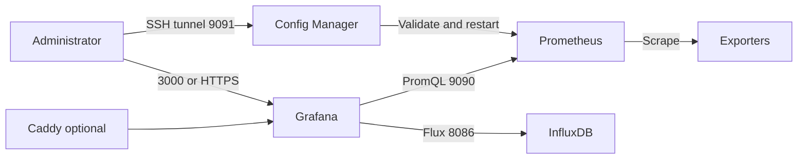

# Monitoring Stack — Prometheus + InfluxDB + Grafana

Docker Compose monitoring with Prometheus configuration management, persistent storage and optional Caddy HTTPS.

## Architecture and network topology



Prometheus and its manager bind to loopback by default. The manager runs in the Prometheus container as an unprivileged process supervisor, without Docker socket access. Only Grafana is exposed by Caddy.

## Prerequisites

- Linux with Docker Engine and Docker Compose v2 (`docker compose`).
- For public mode, an owned domain pointing to your host, reachable TCP 80/443 (and optional UDP 443 for HTTP/3), available host ports, and working A/AAAA records.
- RAM, CPU and disk capacity sized for your telemetry ingestion and retention.

## Private deployment

```bash
git clone https://github.com/ryanit-sys/monitoring-stack.git
cd monitoring-stack
bash scripts/init-env.sh
nano .env # optional settings
docker compose config --quiet
docker compose up -d --build
docker compose ps
```

Access Grafana securely using an SSH tunnel from your computer:

```bash
ssh -L 3000:127.0.0.1:3000 user@SERVER_IP
# http://localhost:3000
```

Log in with Grafana credentials. Prometheus is the default datasource; InfluxDB remains available for historical data.

## Direct IP deployment (no domain)

Set these values in `.env` (replace the example IP with your server IP):

```dotenv
GRAFANA_BIND_IP=0.0.0.0
GRAFANA_PORT=3000
GRAFANA_ROOT_URL=http://192.0.2.10:3000/
INFLUXDB_BIND_IP=127.0.0.1
```

```bash
# Stop and remove Caddy if switching from domain mode.
docker compose --profile public stop caddy
docker compose --profile public rm -f caddy
docker compose up -d
docker compose ps
```

Access `http://SERVER_IP:3000/`. No DNS or Caddy is required. Use a specific host IP instead of 0.0.0.0 to limit listening interfaces. Allow the selected port only from trusted source networks using a Docker-aware firewall (Docker published ports may bypass UFW rules). Direct HTTP does not encrypt credentials or sessions; prefer VPN or HTTPS for Internet access. Keep InfluxDB private. If COMPOSE_PROFILES is set externally, remove public from it before starting direct mode.

## Public HTTPS deployment

1. Create a DNS A record (and correctly routed AAAA if using IPv6) for your host, e.g. `grafana.example.com`.
2. Edit `.env`: set `PUBLIC_DOMAIN=grafana.example.com`, `GRAFANA_ROOT_URL=https://grafana.example.com/` and `GRAFANA_BIND_IP=127.0.0.1`.
3. Allow inbound TCP 80/443, optional UDP 443. **Never expose InfluxDB 8086 publicly.**
4. Run:

```bash
docker compose --profile public up -d
docker compose --profile public ps
docker compose logs --tail=100 caddy
```

Open `https://grafana.example.com`. Caddy manages public TLS certificates automatically when DNS and ACME connectivity work. Changing `PUBLIC_HTTP_PORT`/`PUBLIC_HTTPS_PORT` only changes the host bind and may break automatic HTTP/TLS ACME validation; normally leave 80/443. If an upstream reverse proxy already handles TLS, leave Caddy disabled and restrict access to Grafana's private/loopback listener.

**Security:** Grafana signup and anonymous access are disabled, but public login still attracts attacks. Use strong credentials, firewall/IP allowlists, TLS and optionally MFA/SSO and upstream rate limiting. Do not commit credentials or data.

## Configuration

| Variable | Default | Meaning |
|---|---|---|
| `TZ` | `Asia/Ho_Chi_Minh` | Timezone |
| `GRAFANA_BIND_IP`, `GRAFANA_PORT` | `127.0.0.1`, `3000` | Grafana host interface and port |
| `INFLUXDB_BIND_IP`, `INFLUXDB_PORT` | `127.0.0.1`, `8086` | InfluxDB host interface and port |
| `GRAFANA_ADMIN_USER`, `GRAFANA_ADMIN_PASSWORD` | `admin`, placeholder | Grafana bootstrap credentials |
| `INFLUXDB_USERNAME`, `INFLUXDB_PASSWORD` | `admin`, placeholder | InfluxDB bootstrap credentials |
| `INFLUXDB_ADMIN_TOKEN` | placeholder | InfluxDB operator token used for provisioning |
| `INFLUXDB_ORG`, `INFLUXDB_BUCKET` | `monitoring`, `telegraf` | InfluxDB org and bucket |
| `INFLUXDB_RETENTION` | `30d` | Initial bucket retention |
| `PUBLIC_DOMAIN` | `grafana.example.com` | HTTPS public domain |
| `GRAFANA_ROOT_URL` | `http://localhost:3000` | External Grafana URL; change in public mode |
| `PUBLIC_HTTP_PORT`, `PUBLIC_HTTPS_PORT` | `80`, `443` | Caddy published ports |
| `*_VERSION` | Empty | Latest image tags; InfluxDB defaults to 2.x |

`DOCKER_INFLUXDB_INIT_*` variables only initialize a **new** InfluxDB volume. After first bootstrap, changing secrets, bucket, org or retention in `.env` does **not** modify persisted database settings. Rotate via InfluxDB API/UI and synchronize updated credentials across services. Grafana's environment admin password is similarly a first-run setting; reset existing credentials via Grafana's official UI/CLI. Never use `docker compose down -v` if persistent data matters.

## Image version selection

Leave version variables empty or omit them to use floating tags:

| Variable | Effective default |
|---|---|
| INFLUXDB_VERSION | 2 (latest available 2.x tag) |
| PROMETHEUS_VERSION | latest |
| GRAFANA_VERSION | latest |
| CADDY_VERSION | latest |

InfluxDB 3.x is not compatible with this stack's Flux datasource and 2.x initialization. Do not set INFLUXDB_VERSION to latest or a 3.x tag. For reproducible production deployments, specify tested exact tags, for example INFLUXDB_VERSION=2.7.11. Floating tags do not automatically upgrade running containers; explicitly pull and recreate after reviewing release notes and taking backups.

```bash
docker compose pull
docker compose up -d
# Domain mode instead:
docker compose --profile public pull
docker compose --profile public up -d
```

## Cold-start readiness

The healthcheck uses double-dollar escaping to defer environment expansion to the container shell, not Compose. InfluxDB health checks query the configured bucket with authentication through its Docker network address, rather than merely pinging localhost. This avoids marking the temporary loopback-only initialization server ready. The 120-second start period and 30 retries allow slower initial setup. Grafana still waits for InfluxDB readiness.

If startup fails, inspect `docker compose logs --timestamps influxdb` and `docker inspect "$(docker compose ps -q influxdb)" --format '{{json .State.Health}}'`. Do not delete persistent volumes. Existing volumes must retain matching org, bucket and token settings.

## Prometheus configuration and migration

Existing installations: first back up InfluxDB, Grafana and `.env`, and verify the existing Compose project name with `docker compose ls`. Preserve that name (set `COMPOSE_PROJECT_NAME` explicitly if needed) and inspect the existing named volumes before upgrading. Never run `down -v`. Record a historical Flux query result before upgrading and compare it afterwards. The integration test checks cold start and data persistence across container recreation; this is not a substitute for a legacy migration rehearsal.

Then run `bash scripts/init-env.sh` to generate a missing, short or placeholder Prometheus password without changing existing database credentials. Then run docker compose up -d --build --remove-orphans. This removes the old Telegraf container without deleting InfluxDB data. Keep the existing bucket name and credentials. The legacy Linux dashboard is retained for historical metrics; new host metrics require external exporters such as node_exporter.

Open an SSH tunnel: ssh -L 9091:127.0.0.1:9091 -L 9090:127.0.0.1:9090 user@SERVER_IP. Open http://localhost:9091 and authenticate as admin with PROMETHEUS_CONFIG_PASSWORD. Edit YAML, validate and save (restarts Prometheus), restart without editing, or roll back to the previous configuration. Restart interrupts scraping briefly. Configuration and TSDB are stored in named volumes. Back up both volumes. Do not expose the manager or Prometheus to the Internet; Basic authentication requires a trusted encrypted tunnel. Only trusted administrators may edit scrape targets and configuration.

PROMETHEUS_VERSION defaults to latest; use an exact tag and rebuild with docker compose build --pull prometheus for upgrades. PROMETHEUS_BIND_IP/PORT default to 127.0.0.1/9090; PROMETHEUS_CONFIG_BIND_IP/PORT default to 127.0.0.1/9091.

If Prometheus logs show `Set a strong PROMETHEUS_CONFIG_PASSWORD`, run `bash scripts/init-env.sh` and `docker compose up -d --force-recreate prometheus`. Do not delete volumes. The helper requires Bash and OpenSSL; it does not rotate existing database credentials.

## Backup and restore

```bash
bash scripts/backup.sh
# Or: bash scripts/backup.sh /secure/backup-directory
```

The script takes an **InfluxDB online backup** into `backups/` (gitignored). For full recovery you must also back up the **Grafana named volume consistently** (Grafana's SQLite state), InfluxDB config, Caddy certificate volumes, and `.env` in an encrypted store. Manual Grafana changes are not guaranteed to be represented in provisioned JSON.

To restore, prepare a **clean, compatible target environment** and follow the [official InfluxDB backup/restore instructions](https://docs.influxdata.com/influxdb/v2/admin/backup-restore/). `scripts/restore.sh` refuses destructive automatic restoration by design. Test backups with an isolated recovery drill.

## Git and credential safety

`.env` and backups are ignored. Never put passwords, operator tokens, backup archives or private certificates in Git. If a secret is committed, **rotate it**: removing the file from the latest commit is not enough.

## References

- [InfluxDB Docker Compose](https://docs.influxdata.com/influxdb/v2/install/use-docker-compose/)
- [Grafana InfluxDB datasource](https://grafana.com/docs/grafana/latest/datasources/influxdb/configure/)
- [Grafana provisioning](https://grafana.com/docs/grafana/latest/administration/provisioning/)
- [Caddy reverse proxy](https://caddyserver.com/docs/caddyfile/directives/reverse_proxy)
