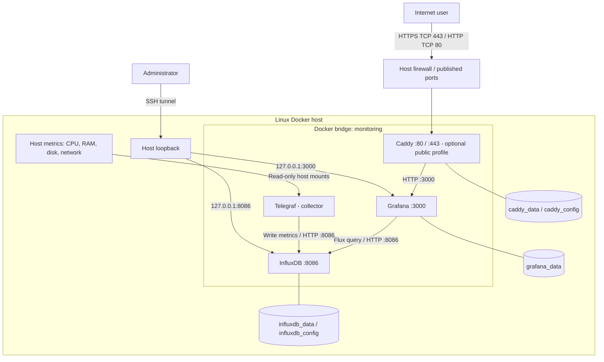

# TIG Stack — Telegraf + InfluxDB 2.x + Grafana

A self-hosted Linux monitoring stack with Docker Compose, automatic Grafana **Flux** datasource and Linux dashboard provisioning, persistent storage, and optional HTTPS reverse proxy (Caddy).

## Architecture and network topology



### Connection matrix

| Source | Destination | Protocol / default port | Purpose |
|---|---|---|---|
| Internet | Caddy | TCP 80/443; optional UDP 443 | HTTP redirect, HTTPS, HTTP/3 |
| Caddy | Grafana | HTTP TCP 3000 | Reverse proxy |
| Grafana | InfluxDB | HTTP TCP 8086 | Flux queries |
| Telegraf | InfluxDB | HTTP TCP 8086 | Metrics ingestion |
| Host loopback | Grafana | TCP 3000 | Private administration |
| Host loopback | InfluxDB | TCP 8086 | Private database administration |

Internal services use Docker DNS names (`grafana`, `influxdb`) on the `monitoring` bridge. By default Grafana and InfluxDB bind only to loopback; Telegraf has no published port. Caddy is enabled only with the `public` profile. Public TLS terminates at Caddy; internal HTTP remains on the Docker network. Host ports can be changed in `.env`; container ports remain unchanged.

## Prerequisites

- Linux with Docker Engine and Docker Compose v2 (`docker compose`).
- For public mode, an owned domain pointing to your host, reachable TCP 80/443 (and optional UDP 443 for HTTP/3), available host ports, and working A/AAAA records.
- RAM, CPU and disk capacity sized for your telemetry ingestion and retention.

## Private deployment

```bash
git clone https://github.com/ryanit-sys/tig-stack.git
cd tig-stack
cp .env.example .env
# Create three DIFFERENT secrets (paste into appropriate .env variables)
openssl rand -hex 32  # GRAFANA_ADMIN_PASSWORD
openssl rand -hex 32  # INFLUXDB_PASSWORD
openssl rand -hex 48  # INFLUXDB_ADMIN_TOKEN
chmod 600 .env
nano .env
docker compose config --quiet
docker compose up -d
docker compose ps
```

Access Grafana securely using an SSH tunnel from your computer:

```bash
ssh -L 3000:127.0.0.1:3000 user@SERVER_IP
# http://localhost:3000
```

Log in with `GRAFANA_ADMIN_USER` and `GRAFANA_ADMIN_PASSWORD`. Grafana preconfigures the `InfluxDB-Flux` datasource and **TIG Stack - Linux Host** dashboard, collecting CPU, RAM, disk and network metrics. After startup, give Telegraf 10–30 seconds to write metrics.

## Public HTTPS deployment

1. Create a DNS A record (and correctly routed AAAA if using IPv6) for your host, e.g. `grafana.example.com`.
2. Edit `.env`: set `PUBLIC_DOMAIN=grafana.example.com` and `GRAFANA_ROOT_URL=https://grafana.example.com/`.
3. Allow inbound TCP 80/443, optional UDP 443. **Never expose InfluxDB 8086 publicly.**
4. Run:

```bash
docker compose --profile public up -d
docker compose --profile public ps
docker compose logs --tail=100 caddy
```

Open `https://grafana.example.com`. Caddy manages public TLS certificates automatically when DNS and ACME connectivity work. Changing `PUBLIC_HTTP_PORT`/`PUBLIC_HTTPS_PORT` only changes the host bind and may break automatic HTTP/TLS ACME validation; normally leave 80/443. If an upstream reverse proxy already handles TLS, leave Caddy disabled and restrict access to Grafana's private/loopback listener.

**Security:** Grafana signup and anonymous access are disabled, but public login still attracts attacks. Use strong credentials, firewall/IP allowlists, TLS and optionally MFA/SSO and upstream rate limiting. Do not commit credentials or data.

## Configuration

| Variable | Default | Meaning |
|---|---|---|
| `TZ` | `Asia/Ho_Chi_Minh` | Timezone |
| `GRAFANA_BIND_IP`, `GRAFANA_PORT` | `127.0.0.1`, `3000` | Grafana host interface and port |
| `INFLUXDB_BIND_IP`, `INFLUXDB_PORT` | `127.0.0.1`, `8086` | InfluxDB host interface and port |
| `GRAFANA_ADMIN_USER`, `GRAFANA_ADMIN_PASSWORD` | `admin`, placeholder | Grafana bootstrap credentials |
| `INFLUXDB_USERNAME`, `INFLUXDB_PASSWORD` | `admin`, placeholder | InfluxDB bootstrap credentials |
| `INFLUXDB_ADMIN_TOKEN` | placeholder | InfluxDB operator token used for provisioning |
| `INFLUXDB_ORG`, `INFLUXDB_BUCKET` | `monitoring`, `telegraf` | InfluxDB org and bucket |
| `INFLUXDB_RETENTION` | `30d` | Initial bucket retention |
| `TELEGRAF_HOSTNAME` | `monitoring-host` | Host metric label |
| `PUBLIC_DOMAIN` | `grafana.example.com` | HTTPS public domain |
| `GRAFANA_ROOT_URL` | `http://localhost:3000` | External Grafana URL; change in public mode |
| `PUBLIC_HTTP_PORT`, `PUBLIC_HTTPS_PORT` | `80`, `443` | Caddy published ports |
| `*_VERSION` | See `.env.example` | Container image versions |

`DOCKER_INFLUXDB_INIT_*` variables only initialize a **new** InfluxDB volume. After first bootstrap, changing secrets, bucket, org or retention in `.env` does **not** modify persisted database settings. Rotate via InfluxDB API/UI and synchronize updated credentials across services. Grafana's environment admin password is similarly a first-run setting; reset existing credentials via Grafana's official UI/CLI. Never use `docker compose down -v` if persistent data matters.

## Monitoring and operations

Telegraf collects CPU, mem, disk, disk I/O, network, kernel, swap and system metrics. It mounts host `/proc`, `/sys` and `/` read-only and runs as root *inside its container* for collection; review this access in production. No Docker socket is mounted. Namespace restrictions can affect host-level network/disk metrics; verify observed series.

```bash
docker compose config --quiet
docker compose ps
docker compose logs --tail=100 influxdb telegraf grafana
docker compose exec telegraf telegraf --test --config /etc/telegraf/telegraf.conf
docker compose exec influxdb influx ping --host http://localhost:8086
# No data? Check the Telegraf logs, datasource and bucket/retention settings.
```

Upgrades: back up first, review image release notes, edit version pins in `.env`, then run:

```bash
docker compose pull
docker compose up -d                    # private
docker compose --profile public up -d   # public
```

For safe shutdown without deleting volumes: `docker compose down`.

## Backup and restore

```bash
bash scripts/backup.sh
# Or: bash scripts/backup.sh /secure/backup-directory
```

The script takes an **InfluxDB online backup** into `backups/` (gitignored). For full recovery you must also back up the **Grafana named volume consistently** (Grafana's SQLite state), InfluxDB config, Caddy certificate volumes, and `.env` in an encrypted store. Manual Grafana changes are not guaranteed to be represented in provisioned JSON.

To restore, prepare a **clean, compatible target environment** and follow the [official InfluxDB backup/restore instructions](https://docs.influxdata.com/influxdb/v2/admin/backup-restore/). `scripts/restore.sh` refuses destructive automatic restoration by design. Test backups with an isolated recovery drill.

## Git and credential safety

`.env` and backups are ignored. Never put passwords, operator tokens, backup archives or private certificates in Git. If a secret is committed, **rotate it**: removing the file from the latest commit is not enough.

## References

- [InfluxDB Docker Compose](https://docs.influxdata.com/influxdb/v2/install/use-docker-compose/)
- [Grafana InfluxDB datasource](https://grafana.com/docs/grafana/latest/datasources/influxdb/configure/)
- [Grafana provisioning](https://grafana.com/docs/grafana/latest/administration/provisioning/)
- [Caddy reverse proxy](https://caddyserver.com/docs/caddyfile/directives/reverse_proxy)
